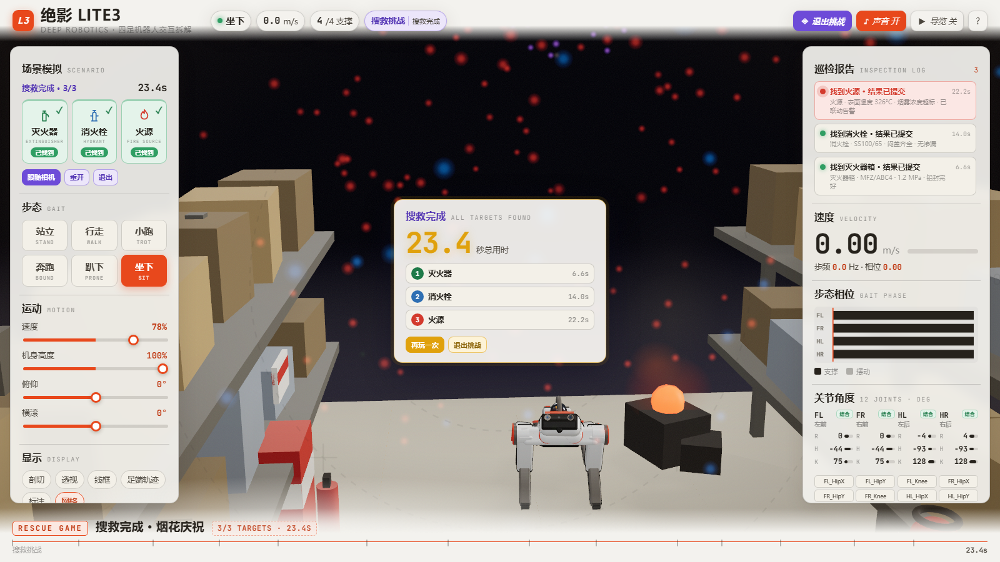
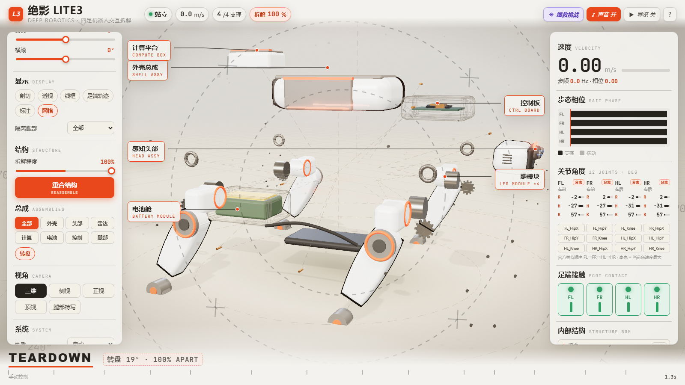
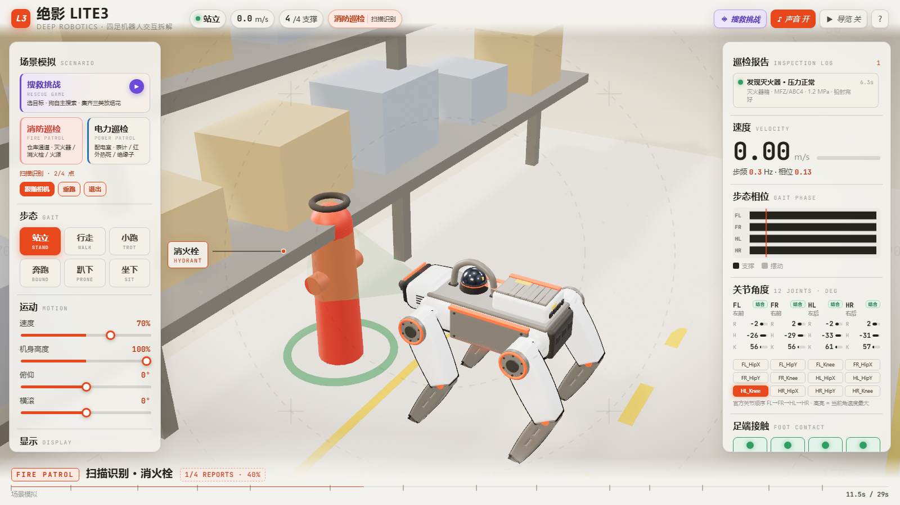
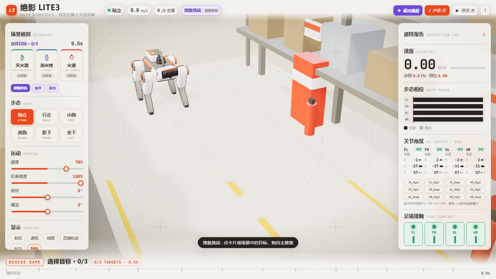
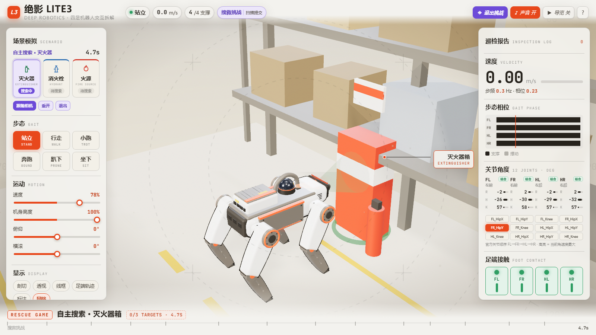
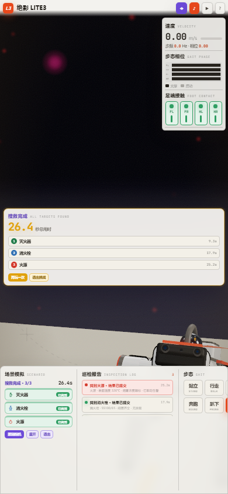

# 绝影 Lite3 · 四足机器狗交互拆解台

一个**离线单文件**的 Three.js 交互页：把 DEEP Robotics 绝影 Lite3 四足机器狗按真机尺寸用代码重建出来，
可以拆解、剖切、换步态、跑场景巡检，还能玩一局「搜救挑战」——选一个目标，狗自己进场景把它找出来并提交结果，
集齐灭火器 / 消火栓 / 火源三类后放烟花结算。

- **在线体验**：<https://jueying-lite3-teardown-ntoojfoe4m9.qoder.website>
- **离线成品**：[`deliverable/lite3-site/dist/index.html`](deliverable/lite3-site/dist/index.html)（约 1 MB，双击即开，无需服务器）
- **源码**：[`sims/lite3-live/`](sims/lite3-live/)　**验收截图**：[`deliverable/qa/`](deliverable/qa/)

<p align="center">
  
</p>

## 功能特色

| 功能 | 示意图 | 说明 |
|---|---|---|
| **交互拆解 / 重合** |  | 0–100% 径向散开与一键重合；外壳 / 头部 / 雷达 / 计算 / 电池 / 控制 / 腿部子系统隔离；剖切、透视、线框、足端轨迹、转盘；常驻引线标注 + 结构 BOM + 12 关节角度条 |
| **场景巡检模拟** |  | 消防巡检 / 电力巡检两条自动任务线：行走 → 扫描锥识别 → 逐点提交巡检报告（正常 / 关注 / 告警），报告日志、任务芯片、跟随相机与自由相机切换 |
| **搜救挑战 · 选目标** |  | 顶栏紫色入口 + 场景面板横幅；三张目标卡（待搜索 / 搜索中 / 已找到），也可以**直接点场景里的实物**选目标（Raycaster 命中判定） |
| **搜救挑战 · 自主搜索** |  | 纯时间线驱动：通道扫视 → 锁定接近 → 扫描 → 提交「找到 ×× · 结果已提交」；搜索期间其余卡片禁用，找到后盖 ✓ 印章 |
| **结算烟花** |  | 3/3 后进入结算：夜幕渐变、圆形柔光粒子烟花（种子化节目单）、坐姿狗转向场地中心观看；两段式机位（近景狗 → 拉远全景），结算面板给出总用时与找到顺序，可再玩一次 / 退出 |
| **移动端适配** |  | 窄屏下控制台收进横向抽屉，目标卡改竖排，结算面板与报告日志独立滚动，无横向溢出 |

其它细节：阻尼拖拽环绕 + 滚轮缩放（像素比封顶）、空闲自动导览带光标、事件音效默认开且顶栏一键静音、
暂停 / 重开 / 退出全程状态不漂移、三档画质适配集显。

## 搜救挑战玩法 loop


每次搜索都是**加载时一次性算好的纯时间线**（`buildHunt` → `huntPose(t)`），所以暂停、重开、回放逐帧一致，不会漂移。

## 模块结构

```
sims/lite3-live/
├── kin.js       真机尺寸 / 关节限位 / 外展 IK / 步态表 / BOM（唯一数据源）
├── dog.js       程序化几何：机身、腿模块、雷达、电池舱… 逐件状态与材质分组
├── mission.js   场景数据 + 纯函数巡检时间线（消防 / 电力）
├── game.js      搜救挑战时间线：三类目标、搜索航点、扫描与提交事件
├── scene.js     场景道具（货架 / 灭火器箱 / 消火栓 / 火源 / 配电柜）与扫描特效
├── fx.js        结算烟花：池化 Points、加色混合、圆形柔光贴图、种子化节目单
├── stage.js     灯光 rig / 阴影 / 选择性辉光 / 夜幕 setDusk / 画质分档
├── console.js   控制台 UI：顶栏、面板、报告日志、游戏卡片、结算 overlay
├── main.js      控制器：游戏状态机、点选、相机机位、事件接线、音效触发
├── film.js      自动导览脚本（与捕获共用同一时间线）
└── style.css    视觉：暖纸底 + 墨黑 + 朱橙 accent，游戏紫 / 结算金
```

## 使用的 Skill 与技术

**Skill（Qoder）**

| Skill | 在本项目中的作用 |
|---|---|
| `teardown` | 单页模拟器管线：`sims/build.mjs` 打包、`capture.mjs` 逐帧捕获、"渲染 → 看帧 → 修 → 再看" 的审查循环与验收清单 |
| `img2threejs` | 参考图 → 程序化 Three.js 重建的质量门流程：先观察分解、写规格、分 pass 构建、截图对照参考图逐轮修正 |
| `sites:sites-hosting` | Qoder Sites 发布链：`prepare_site` → `get_publish_status` → `publish_site` → `show_publish_confirmation`，并回读线上页面确认是新包 |

**技术栈**

| 技术 | 用途 |
|---|---|
| Three.js 0.186 | 全程序化几何（无外部模型文件）、OrbitControls 阻尼环绕、Raycaster 场景点选、PMREM 环境光 |
| 纯时间线模型 | `render(t)` / `missionPose(t)` / `huntPose(t)` 均为时间的纯函数，暂停 / 重开 / 捕获逐帧可复现 |
| 加色粒子烟花 | 池化 `Points` + 径向渐变贴图 + `toneMapped:false`，夜幕下不被曝光压暗；选择性辉光层只让火花 bloom |
| WebAudio 合成音效 | 选取 / 扫描 / 提交 / 点火 / 爆开 / 结算 fanfare 全部代码合成，默认开、顶栏一键静音 |
| esbuild 0.28 | three.js 与字体内联进单个 HTML（< 1 MB，利于分享卡片抓取） |
| Playwright 1.63 | 无头 Chromium（SwiftShader）跑桌面 + 移动端全流程回归与截图验收 |
| Qoder Sites | 托管发布与线上验证 |

## 本地运行

```bash
npm install && npx playwright install chromium   # 仅首次
node sims/build.mjs lite3-live                   # → sims/dist/lite3-live.html
# 双击打开该 HTML 即可玩；?capture 进入逐帧捕获模式
```

回归探针（全部针对打包后的单页）：

```bash
node probe3.mjs   # 展台：步态 / 滑杆 / 显示模式 / 拆解 / 暂停 / 键位
node probe4.mjs   # 导览镜头与拆解演出、移动端抽屉、快速连点
node probe5.mjs   # 结构升级：IK 往返 / 关节限位 / BOM 选择 / 关节条
node probe6.mjs   # 消防 / 电力巡检全流程 + 暂停 / 重开 / 接管 / 移动端
node probe7.mjs   # 搜救挑战全流程：选目标 → 搜索 → 提交 → 烟花 → 重开 / 退出 / 场景点选 / 移动端
```

## 发布与备份

- 线上地址见页首；每次内容变更用**新的 actionId** 走 prepare → publish → confirm 链，发布后回读线上 HTML 确认字节数与游戏入口字符串。
- 本仓库为**私有备份**：`deliverable/lite3-site/` 存已发布成品与站点描述文件，`deliverable/refs/` 存重建对照参考图，`deliverable/qa/` 存最终验收截图。
- 换机恢复：clone 本仓库 → `npm install` → `node sims/build.mjs lite3-live`，或直接打开 `deliverable/lite3-site/dist/index.html`。

## 上游与许可

模拟管线来自 [whaleyxbt/claude-motion](https://github.com/whaleyxbt/claude-motion)（MIT），本仓库在其 `sims/` 管线上扩展了 `lite3-live` 整机与游戏模式；
上游的运动设计 / 审查循环 / 声音引擎文档见 [`AGENTS.md`](AGENTS.md) 与 `.claude/skills/`。
参考图来自 DEEP Robotics 公开资料，仅用于重建对照。代码许可：[MIT](LICENSE)。